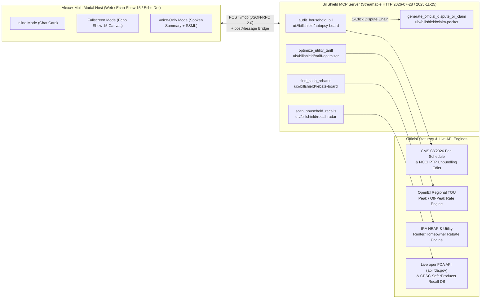

# BillShield MCP — Autonomous Household Financial Defense & Recall Claim Add-on for Alexa+

[](#)
[](./certification-verdict.json)
[-38BDF8?style=flat-square)](#)
[](./LICENSE)

**BillShield MCP** is a multi-modal **Alexa+ Model Context Protocol (MCP) Add-on** (`Inline`, `Fullscreen`, and `Voice-only`) that acts as an autonomous household financial auditor for both **renters** and **homeowners**. Built on a **19-tool hybrid agentic architecture** (Atomic Live Public APIs + Pure Parameterized Math Calculators with zero hardcoded constants + V8 Code Mode Sandbox + One-Shot Workflows), families can ask Alexa+ by voice or web chat to audit inflated medical/ISP bills, optimize electric peak/off-peak utility tariffs, unlock renter-safe cash rebates, scan kitchen/nursery items for CPSC & openFDA cash recall refunds, and generate statute-cited dispute packets ready to sign and send.

> Built on top of our companion open-source SDK **[`alexa-mcp-kit`](https://github.com/savhascelik/alexa-mcp-kit)** and verified with our fast **Pre-Flight Readiness Linter** ([`certification-verdict.json`](./certification-verdict.json)), designed to pair directly with Amazon's official **`npx @alexa-ai/addon-local-inspector`**. Supports both the latest **`2026-07-28`** Stateless Streamable HTTP MCP specification and **`2025-11-25` / `2025-06-18`** Stateful `Mcp-Session-Id` negotiation. See [`FRICTION_LOG.md`](./FRICTION_LOG.md) for our detailed Alexa+ MCP Toolkit engineering feedback.

---

## Why BillShield MCP? (Zero Homeowner/Renter Friction)

American households lose **$2,400–$4,800 per year** to four invisible bureaucratic leaks:
1. **Upcoded & Unbundled Bills ($876.36 avg. overcharge):** Hospital ER bills and ISP statements routinely bundle mutually exclusive CPT codes (`NCCI Column 1/2 edits`), duplicate radiology line items, or charge "$15/mo customer-owned router rental fees."
2. **Peak-Hour Electric Tariff Traps ($1,444.68/yr loss):** Utilities on Time-of-Use (TOU) schedules charge up to **2.16x more** between 4 PM and 9 PM, yet families run dryers, dishwashers, and EV chargers during peak windows without realizing the exact dollar penalty.
3. **Unclaimed Renter-Safe Cash Rebates ($2,560.00 available):** Renters assume federal IRA / utility incentives only apply to homeowners replacing roofs or furnaces, missing out on **100% portable, zero-landlord-permission rebates** (window heat pumps, plug-in induction cooktops, smart thermostats, and community solar bill credits).
4. **Unclaimed CPSC & FDA Recall Refunds ($154.00+ per household):** Millions of recalled kitchen appliances, nursery monitors, and OTC medications qualify for **no-receipt cash refunds**, sitting untouched in cupboards.

---

## System Architecture



---

## Quickstart (Zero Config, Node.js >= 20)

```bash
# 1. Start the BillShield Alexa+ MCP Server + Multimodal Device Simulator
npm start
# -> Alexa+ Streamable HTTP MCP Endpoint: http://127.0.0.1:4040/mcp
# -> Alexa+ 3-Mode Interactive Device Simulator: http://127.0.0.1:4040/simulator
```

### Run Pre-Certification Audit & Verification Suite

```bash
# Generate certification-verdict.json and inspection-summary.json
npm run cert

# Run full automated verification suite (Engines + MCP Server + Simulator + Live API Tools + Parameterized Math + Code Mode)
npm test
```

### Inspect with Official Amazon Local Inspector

```bash
npx @alexa-ai/addon-local-inspector http://127.0.0.1:4040/mcp
```

---

## The 19 Alexa+ MCP Tools & 6 `ui://` App Resources

BillShield MCP exposes **19 registered MCP tools** organized into 5 layers so Alexa+ can either invoke a single composite tool or chain atomic API + parameterized math tools inside **Code Mode (`execute_codemode`)**:

| Layer | Registered Tools | Bound `ui://` Resource(s) | Purpose |
| :--- | :--- | :--- | :--- |
| **1. Atomic Live Public APIs (5)** | `api_lookup_medical_code`, `api_lookup_locality_gpci`, `api_query_fda_enforcement`, `api_query_cpsc_recalls`, `api_lookup_utility_rates` | `ui://billshield/agent-surface` | Queries live U.S. government APIs (`clinicaltables.nlm.nih.gov`, `api.zippopotam.us`, `api.fda.gov`, `saferproducts.gov`) and returns raw RVU/GPCI/tariff data with zero hardcoded price math. |
| **2. Pure Parameterized Math Calculators (4)** | `calc_medicare_fee_formula`, `calc_line_item_variance`, `calc_tou_load_shift`, `calc_income_ami_subsidy` | `ui://billshield/agent-surface` | Zero-hardcoded-constant calculators where Alexa+ supplies dynamic policy parameters (`conversionFactor`, `allowedMultiplier`, `currentRatePerKwh`, `coverageRate`). |
| **3. Dynamic UI & Dispute Builders (2)** | `render_echo_show_surface`, `build_dispute_document` | `ui://billshield/agent-surface`, `ui://billshield/claim-packet` | Renders arbitrary agent-computed metrics/rows onto the Echo Show 8/15 canvas or builds a formal dispute packet embedding the exact `formulaTrace`. |
| **4. Progressive Discovery & V8 Code Mode (3)** | `search_tools`, `describe_tool`, `execute_codemode` | `ui://billshield/agent-surface` | Saves ~68%–92% prompt tokens on discovery and executes multi-step JS plans in an isolated `node:vm` sandbox. |
| **5. Composite One-Shot Household Workflows (5)** | `audit_household_bill`, `optimize_utility_tariff`, `find_cash_rebates`, `scan_household_recalls`, `generate_official_dispute_or_claim` | `ui://billshield/autopsy-board`, `tariff-optimizer`, `rebate-board`, `recall-radar`, `claim-packet` | High-level convenience workflows for single-turn voice interactions, supporting dynamic `conversionFactor` and `zipCode` parameters. |

---

## Interactive Device Sandbox & Example Workflows (`http://127.0.0.1:4040/simulator`)

BillShield MCP includes an interactive multi-modal workbench (`GET /simulator`) for testing `ui://` widgets across **`Inline`**, **`Fullscreen`**, and **`Voice-only`** display modes, as well as executing custom live voice/chat commands and multi-step `execute_codemode` plans:

1. **Medical & ISP Bill Autopsy (`audit_household_bill`):**
   - Queries live **NIH Clinical Tables** (`clinicaltables.nlm.nih.gov`), **openFDA National Drug Code (NDC)** (`api.fda.gov/drug/ndc.json`), and **Zippopotam.us** locality GPCI indices before auditing line items against CMS Physician Fee Schedule RVU weights and NCCI Procedure-to-Procedure (PTP) unbundling rules.
   - Detects upcoding (e.g., `CPT 99285` vs. `99284`), mutually exclusive bundled procedures (`CPT 36415` with `80053`), duplicate imaging charges (`CPT 71046`), and unlawful customer-owned router rental fees (`47 CFR § 76.1205`).
2. **Adaptive 3-Display-Mode Switching (`Inline` ↔ `Fullscreen` ↔ `Voice-only`):**
   - **Inline Mode:** Compact 2-KPI summary card designed for the Alexa+ conversational stream.
   - **Fullscreen Mode:** Split-screen itemized audit table and action bar designed for Echo Show 8 / 15 and Fire TV (`>= 48px` touch targets, `6.47:1` minimum WCAG 2.1 AA contrast).
   - **Voice-Only Mode:** Spoken summary transcript and `<speak><prosody>` SSML output for headless Echo Dot / Echo Auto devices.
   - Interactive widget buttons dispatch standard MCP Apps `window.parent.postMessage` (`method: "tools/call"`) events—for example, chaining directly from an itemized bill audit into `generate_official_dispute_or_claim` (`ui://billshield/claim-packet`).
3. **Renter-Safe Cash Rebates & 50-State Utility Tariff Optimizer (`find_cash_rebates` & `optimize_utility_tariff`):**
   - Resolves any U.S. ZIP code via live geolocation (`api.zippopotam.us`) and filters federal IRA HEAR / utility rebates by `tenure: "renter" | "homeowner"` so renters only see 100% portable upgrades requiring zero landlord permission.
   - Computes appliance-level Peak-to-Off-Peak Time-of-Use (TOU) load-shift savings across all 50 U.S. states and D.C.
4. **Live CPSC & openFDA Recall Cash Refunds (`scan_household_recalls`):**
   - Queries the live **U.S. CPSC SaferProducts API** (`saferproducts.gov`) and **openFDA Enforcement API** (`api.fda.gov`) for every scanned household item to surface active recall notices and no-receipt cash/replacement remedies.

---

## Repository Structure

```text
billshield-mcp/
├── src/
│   ├── server.mjs                 # Streamable HTTP (2026-07-28 + 2025-11-25) MCP Server (19 tools, 6 ui:// resources)
│   ├── simulator.mjs              # Interactive Alexa+ 3-Mode Web Simulator + Live Custom Command Tester (GET /simulator)
│   ├── run-cert.mjs               # Pre-certification runner emitting certification-verdict.json
│   ├── tools/
│   │   ├── api-tools.mjs          # 5 Atomic Live Public API tools (NIH, Zippopotam, openFDA NDC & Enforcement, CPSC)
│   │   ├── calc-tools.mjs         # 4 Pure Parameterized Math Calculator tools (zero hardcoded policy constants)
│   │   └── ui-tools.mjs           # 2 Dynamic Echo Show UI & Dispute Packet builder tools
│   └── engines/
│       ├── bill-autopsy.mjs       # CMS CY2026 Fee Schedule & NCCI PTP unbundling auditor
│       ├── utility-tariff.mjs     # 50-State + DC OpenEI Time-of-Use Peak/Off-Peak optimizer
│       ├── rebate-finder.mjs      # Renter vs. Homeowner IRA/HEAR cash rebate engine
│       ├── recall-scanner.mjs     # Live openFDA + CPSC household recall refund scanner
│       └── dispute-generator.mjs  # Statute-cited dispute & claim packet generator
├── lib/
│   └── alexa-mcp-kit/             # Bundled copy of our open-source Alexa+ MCP SDK & Auditor
├── tests/
│   ├── check_engines.mjs            # Phase 1: Core domain engines & live openFDA recall matching
│   ├── check_mcp_server.mjs         # Phase 2: Streamable HTTP MCP server (19 tools & 6 ui:// resources)
│   ├── check_simulator_and_cert.mjs # Phase 3: Simulator UI, 7/7 certification audit & negative compliance checks
│   ├── check_phase5_api_tools.mjs   # Phase 5: Atomic live public API tools & MCP schema compatibility
│   ├── check_phase6_calc_tools.mjs  # Phase 6: Parameterized math calculators (dynamic conversionFactor & multipliers)
│   ├── check_phase7_agentic_flow.mjs# Phase 7: Progressive tool discovery & 7-step V8 Code Mode sandbox execution
│   └── verify_all.mjs               # Master verification suite runner
├── certification-verdict.json     # Automated pre-certification verdict ("CERTIFIED", 7/7 rules)
├── inspection-summary.json        # Detailed per-tool & per-resource inspection report
├── FRICTION_LOG.md                # Alexa+ MCP Toolkit engineering architecture & developer friction notes
└── package.json
```
